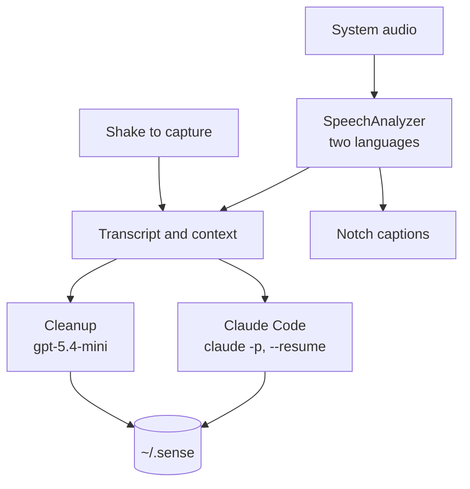

<div align="center">

<h1>sense</h1>

<p><strong>macOS senses for Claude Code: live captions of what you hear, and capture of what you point at.</strong></p>

[](https://github.com/zyx1121/sense/actions)
[](https://github.com/zyx1121/sense/releases)
[](Package.swift)
[](LICENSE)

**English** | [繁體中文](README.zh-TW.md) | [简体中文](README.zh-CN.md)

</div>

In a lecture, a meeting or a video, you either take notes with half your attention or take none. sense keeps a live caption under the notch and a running transcript beside it. You stay in the room and ask about what you just heard. Only two parts use the network: a small model that tidies the transcript, and your own Claude Code.

## Features

- **Captions under the notch**: system audio, transcribed on the Mac. Draft text is grey and turns white when final.
- **Follows Chinese and English**: two recognizers run at once, and sense follows the one with the higher confidence.
- **Keeps a clean transcript**: a small model fixes punctuation and recognition errors in batches. Each section shows its time and its source app.
- **Answers with Claude Code**: Ask Sense sends your question and the recent transcript to headless Claude Code, which can also write notes to `~/.sense/`.
- **Captures by voice and gesture**: hold right ⇧ to dictate, or shake the cursor to capture a UI element. Meeting mode adds your own voice.

## Quick start

Download the latest DMG from [Releases](https://github.com/zyx1121/sense/releases/latest), or build it without Xcode:

```sh
make run       # build, bundle, codesign and open
make install   # copy to /Applications, which launch at login and stable permissions need
```

Grant Screen Recording and Accessibility when macOS asks. Play any video, and the caption appears under the notch.

## Usage

- **Menu bar**: open the transcript folder, resize the overlay or clear the conversation. Other items open permission settings, set the login item, restart and quit.
- **Overlay**: drag its title bar to move it. ⌘= and ⌘- resize it, and ⌘0 resets it. Type `/clear` to clear the conversation. The pin keeps it open.
- **Files**: drop files from Finder on the overlay. Claude Code reads each one by its path.
- **Push-to-talk**: hold right ⇧ and speak. Your words appear in the input field. The microphone is open only while you hold the key.
- **Meeting mode**: system audio never contains your own voice. Turn on meeting mode, and the microphone adds your speech to the transcript as **我**.
- **Shake to capture**: wiggle the cursor, left-click the elements that you want, and right-click to finish. The captures go to Claude Code on the next turn.
- **Languages**: `Sense --langs zh-TW,en-US` (the default) follows both. `Sense --lang ja-JP` uses one. `make locales` lists the supported languages.

## Configuration

| Needs | For | Without it |
|-------|-----|------------|
| macOS 26 or later | SpeechAnalyzer | sense does not run |
| `claude` on `PATH` | Ask Sense, with your Claude Code login | captions and the transcript still work |
| `OPENAI_API_KEY`, or the Keychain item `service=sense account=openai` | transcript cleanup with `gpt-5.4-mini` | raw text passes through |
| `SIGN_ID` in `Makefile.local` | signing with your Apple Development certificate | ad-hoc signing |
| Screen Recording, Accessibility, Microphone | audio and screenshots, shake capture, dictation | macOS asks on first use |

## How it works



- Apple's recognizer emits each utterance twice: drafts that it keeps rewriting, then a final. Drafts are only for the screen.
- Finals wait in a queue. The queue goes to cleanup after 60 characters, a language switch or 4 seconds of silence, whichever comes first.
- The small model does only the uncertain work: punctuation and recognition errors. Plain code joins paragraphs, stitches batches and removes echoes.
- The polished transcript goes to `~/.sense/transcripts/YYYY-MM-DD.md`.

## Privacy

| Data | Goes to |
|------|---------|
| System audio | SpeechAnalyzer on the Mac. The audio never leaves it |
| Microphone audio | the Mac only, and only while you hold the key or meeting mode is on |
| Transcript text | OpenAI `gpt-5.4-mini`, with your own key, for cleanup |
| Your question, the recent transcript and the captures | Anthropic, through your own Claude Code login |
| Notes and the transcript archive | `~/.sense` on the Mac. Nothing uploads them |

sense bundles no keys and sends nothing through the author's servers.

## Limits

- macOS 26 or later, for SpeechAnalyzer.
- Meeting mode records your voice only from the Mac microphone.

## For AI agents

Facts for coding agents and LLM tools. The rules for changing the code are in [AGENTS.md](AGENTS.md).

- **Summary**: Swift macOS menu bar app with live captions of system audio, a cleaned transcript, push-to-talk, shake-to-capture, and headless Claude Code for questions.
- **Type**: app
- **Interfaces**: menu bar and overlay UI. CLI flags `--langs` and `--lang` on the app binary. Spawns `claude -p` with stream JSON.
- **Install**: the DMG from https://github.com/zyx1121/sense/releases/latest, or `make install`
- **Run**: `make run`
- **Verify**: `make bundle`, then play audio and watch `make logs` for `asr` events
- **Config**: `SIGN_ID` and `DEV_ID_APP` in `Makefile.local`. `OPENAI_API_KEY` or the Keychain item `sense`/`openai`.
- **Secrets**: the OpenAI key, from the environment or the Keychain. Claude Code keeps its own login. Release signing uses repo secrets.
- **Limits**: macOS 26 or later. Cleanup needs an OpenAI key, and Ask Sense needs `claude`.

## Development

```sh
make run       # build and open
make logs      # live telemetry: asr, polish, agent, shake
make dmg       # unsigned DMG
make release   # Developer ID signing, notarization and a DMG
make publish   # release, then upload the DMG to a GitHub release
```

CI runs `swift build -c release`. A `v*` tag runs `make release` in CI and publishes the GitHub release. The design notes in [docs/](docs/) are in Traditional Chinese.

## License

[MIT](LICENSE)
