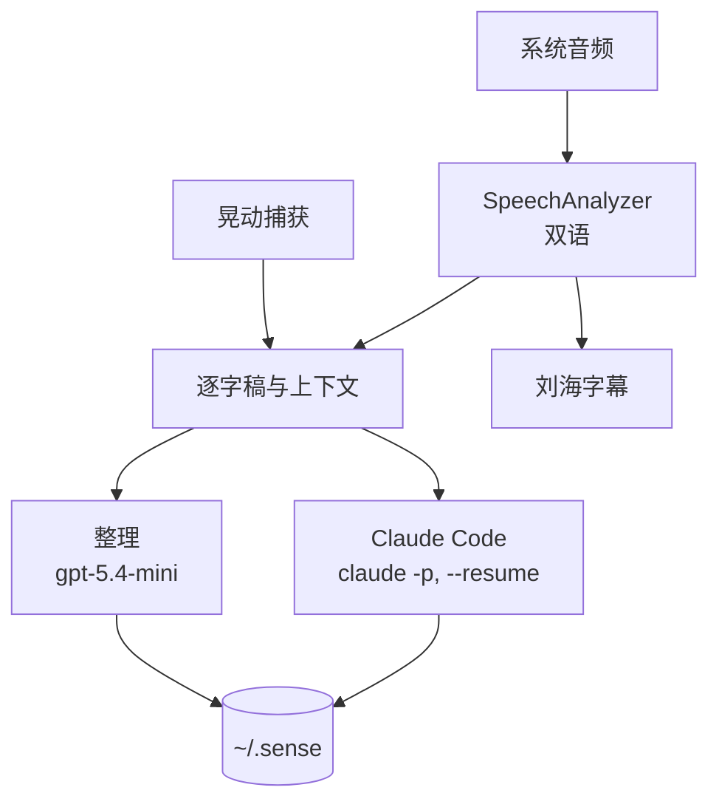

<!-- 翻译自 README.md @ docs/readme-template-v2。只翻 "For AI agents" 以上的章节，英文版更新时一起改。 -->

<div align="center">

<h1>sense</h1>

<p><strong>给 Claude Code 的 macOS 感官：实时字幕你听到的，捕获你指到的。</strong></p>

[](https://github.com/zyx1121/sense/actions)
[](https://github.com/zyx1121/sense/releases)
[](Package.swift)
[](LICENSE)

[English](README.md) | [繁體中文](README.zh-TW.md) | **简体中文**

</div>

上课、开会、看视频时，不是分心记笔记，就是干脆不记。sense 在刘海下显示实时字幕，旁边累积完整逐字稿。你可以专心听，再问刚才听到的内容。只有两个部分会联网：整理逐字稿的小模型，和你自己的 Claude Code。

## 功能

- **刘海字幕**：系统音频在 Mac 上转写。草稿是灰字，定稿后变白字。
- **中英文自动切换**：两个识别器同时运行，sense 跟随置信度较高的那一个。
- **干净的逐字稿**：小模型分批修正标点与识别错误。每段标注时间与来源 app。
- **用 Claude Code 回答**：Ask Sense 把你的问题与最近的逐字稿交给 headless Claude Code，它也能把笔记写进 `~/.sense/`。
- **语音与手势捕获**：按住右 ⇧ 口述，或晃动光标捕获界面元素。会议模式会加入你自己的声音。

## 快速开始

从 [Releases](https://github.com/zyx1121/sense/releases/latest) 下载最新的 DMG，或不用 Xcode 自行构建：

```sh
make run       # 构建、打包、签名并打开
make install   # 复制到 /Applications，登录时启动与稳定的权限都需要这步
```

macOS 询问时，允许「屏幕录制」与「辅助功能」。播放任意视频，刘海下就会出现字幕。

## 使用方式

- **菜单栏**：打开逐字稿文件夹、调整浮窗大小、清除对话。其他项目可打开权限设置、设置登录项、重新启动与退出。
- **浮窗**：拖动标题栏移动。⌘= 与 ⌘- 调整大小，⌘0 重置。输入 `/clear` 清除对话。图钉让浮窗保持展开。
- **文件**：从 Finder 把文件拖到浮窗上。Claude Code 按路径读取每个文件。
- **按住说话**：按住右 ⇧ 说话，文字会出现在输入框。只有按住时麦克风才打开。
- **会议模式**：系统音频不含你自己的声音。打开会议模式后，麦克风会把你的话以 **我** 加入逐字稿。
- **晃动捕获**：晃动光标，左键点选想要的元素，右键结束。捕获内容在下一轮交给 Claude Code。
- **语言**：`Sense --langs zh-TW,en-US`(默认)同时跟随两种语言。`Sense --lang ja-JP` 只用一种。`make locales` 列出支持的语言。

## 配置

| 需要 | 用途 | 没有时 |
|------|------|--------|
| macOS 26 以上 | SpeechAnalyzer | sense 无法运行 |
| `PATH` 上有 `claude` | Ask Sense，使用你的 Claude Code 登录 | 字幕与逐字稿照常运行 |
| `OPENAI_API_KEY`，或钥匙串项目 `service=sense account=openai` | 用 `gpt-5.4-mini` 整理逐字稿 | 原文直出 |
| `Makefile.local` 里的 `SIGN_ID` | 用你的 Apple Development 证书签名 | ad-hoc 签名 |
| 屏幕录制、辅助功能、麦克风 | 音频与截图、晃动捕获、口述 | 首次使用时 macOS 会询问 |

## 工作原理



- Apple 的识别器对每句话输出两次：先是不断改写的草稿，再是定稿。草稿只用于界面。
- 定稿先进队列。累积 60 字、切换语言或静默 4 秒，任一条件先到就送去整理。
- 小模型只做不确定的工作：标点与识别错误。分段、拼接批次与去重都由普通代码处理。
- 整理后的逐字稿存到 `~/.sense/transcripts/YYYY-MM-DD.md`。

## 隐私

| 数据 | 去向 |
|------|------|
| 系统音频 | Mac 上的 SpeechAnalyzer。音频不会离开 Mac |
| 麦克风音频 | 只在 Mac 上，且只在按住按键或会议模式打开时 |
| 逐字稿文本 | OpenAI `gpt-5.4-mini`，用你自己的密钥整理 |
| 你的问题、最近的逐字稿与捕获内容 | Anthropic，通过你自己的 Claude Code 登录 |
| 笔记与逐字稿归档 | Mac 上的 `~/.sense`，不会上传 |

sense 不内置任何密钥，也不经过作者的服务器。

## 限制

- 需要 macOS 26 以上(SpeechAnalyzer)。
- 会议模式只从 Mac 的麦克风收录你的声音。

## 其他

给 AI agent 的结构化信息与开发说明在[英文版](README.md#for-ai-agents)。

## 许可证

[MIT](LICENSE)
