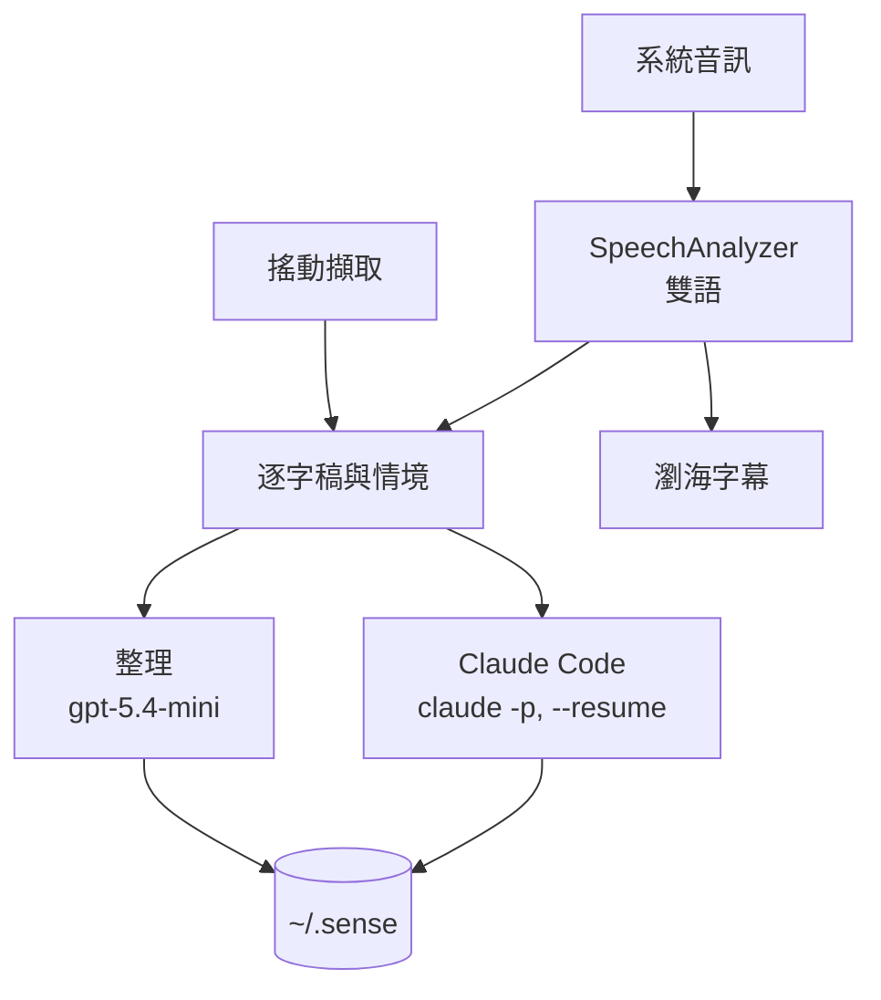

<!-- 翻譯自 README.md @ docs/readme-template-v2。只翻 "For AI agents" 以上的章節，英文版更新時一起改。 -->

<div align="center">

<h1>sense</h1>

<p><strong>給 Claude Code 的 macOS 感官：即時字幕你聽到的，擷取你指到的。</strong></p>

[](https://github.com/zyx1121/sense/actions)
[](https://github.com/zyx1121/sense/releases)
[](Package.swift)
[](LICENSE)

[English](README.md) | **繁體中文** | [简体中文](README.zh-CN.md)

</div>

上課、開會、看影片時，不是分心抄筆記，就是乾脆不抄。sense 在瀏海下顯示即時字幕，旁邊累積完整逐字稿。你可以專心聽，再問剛剛聽到的內容。只有兩個部分會連網：整理逐字稿的小模型，和你自己的 Claude Code。

## 功能

- **瀏海字幕**：系統音訊在 Mac 上轉寫。草稿是灰字，定稿後變白字。
- **中英文自動切換**：兩個辨識器同時跑，sense 跟隨信心較高的那一個。
- **乾淨的逐字稿**：小模型分批修正標點與辨識錯誤。每段標示時間與來源 app。
- **用 Claude Code 回答**：Ask Sense 把你的問題與最近的逐字稿交給 headless Claude Code，它也能把筆記寫進 `~/.sense/`。
- **語音與手勢擷取**：按住右 ⇧ 口述，或搖動游標擷取畫面元素。會議模式會加入你自己的聲音。

## 快速開始

從 [Releases](https://github.com/zyx1121/sense/releases/latest) 下載最新的 DMG，或不用 Xcode 自己建置：

```sh
make run       # 建置、打包、簽章並開啟
make install   # 複製到 /Applications，登入時啟動與穩定的權限都需要這步
```

macOS 詢問時，允許「螢幕錄製」與「輔助使用」。播放任何影片，瀏海下就會出現字幕。

## 使用方式

- **選單列**：開啟逐字稿資料夾、調整浮窗大小、清除對話。其他項目可開啟權限設定、設定登入項目、重新啟動與結束。
- **浮窗**：拖曳標題列移動。⌘= 與 ⌘- 調整大小，⌘0 重設。輸入 `/clear` 清除對話。圖釘讓浮窗保持展開。
- **檔案**：從 Finder 把檔案拖到浮窗上。Claude Code 依路徑讀取每個檔案。
- **按住說話**：按住右 ⇧ 說話，文字會出現在輸入框。只有按住時麥克風才開啟。
- **會議模式**：系統音訊不含你自己的聲音。開啟會議模式後，麥克風會把你的話以 **我** 加入逐字稿。
- **搖動擷取**：搖動游標，左鍵點選想要的元素，右鍵結束。擷取內容在下一輪交給 Claude Code。
- **語言**：`Sense --langs zh-TW,en-US`(預設)同時跟隨兩種語言。`Sense --lang ja-JP` 只用一種。`make locales` 列出支援的語言。

## 設定

| 需要 | 用途 | 沒有時 |
|------|------|--------|
| macOS 26 以上 | SpeechAnalyzer | sense 無法執行 |
| `PATH` 上有 `claude` | Ask Sense，使用你的 Claude Code 登入 | 字幕與逐字稿照常運作 |
| `OPENAI_API_KEY`，或 Keychain 項目 `service=sense account=openai` | 用 `gpt-5.4-mini` 整理逐字稿 | 原文直出 |
| `Makefile.local` 裡的 `SIGN_ID` | 用你的 Apple Development 憑證簽章 | ad-hoc 簽章 |
| 螢幕錄製、輔助使用、麥克風 | 音訊與截圖、搖動擷取、口述 | 第一次使用時 macOS 會詢問 |

## 運作方式



- Apple 的辨識器對每句話輸出兩次：先是持續改寫的草稿，再來是定稿。草稿只用於畫面。
- 定稿先進佇列。累積 60 字、切換語言或靜默 4 秒，任一條件先到就送去整理。
- 小模型只做不確定的工作：標點與辨識錯誤。分段、接合批次與去除重複都由一般程式處理。
- 整理後的逐字稿存到 `~/.sense/transcripts/YYYY-MM-DD.md`。

## 隱私

| 資料 | 去處 |
|------|------|
| 系統音訊 | Mac 上的 SpeechAnalyzer。音訊不會離開 Mac |
| 麥克風音訊 | 只在 Mac 上，且只在按住按鍵或會議模式開啟時 |
| 逐字稿文字 | OpenAI `gpt-5.4-mini`，用你自己的金鑰整理 |
| 你的問題、最近的逐字稿與擷取內容 | Anthropic，透過你自己的 Claude Code 登入 |
| 筆記與逐字稿封存 | Mac 上的 `~/.sense`，不會上傳 |

sense 不內建任何金鑰，也不經過作者的伺服器。

## 限制

- 需要 macOS 26 以上(SpeechAnalyzer)。
- 會議模式只從 Mac 的麥克風收你的聲音。

## 其他

給 AI agent 的結構化資訊與開發說明在[英文版](README.md#for-ai-agents)。

## 授權

[MIT](LICENSE)
